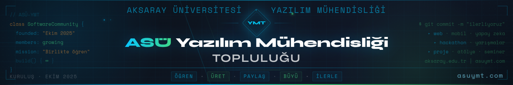

  

<h1 align="center">ASÜ Yazılım Mühendisliği Topluluğu</h1>

  <strong>Birlikte öğren, üret, paylaş.</strong> 
  <em>“Etrafındakilerin ortalaması kadarsın.”</em>

---

 

## 🌐 Genel Bakış

**ASÜ Yazılım Mühendisliği Topluluğu (ASÜ-YMT)**, yazılım ve teknolojiye ilgi duyan öğrencilerin bir araya gelerek bilgi ve tecrübelerini paylaşmalarını, birlikte öğrenmelerini, projeler geliştirmelerini ve kendilerini geleceğe en iyi şekilde hazırlamalarını sağlamak amacıyla **Ekim 2025**’te kurulmuştur.

> “Birlikte öğrenen, birlikte üreten, birlikte büyüyen bir topluluk.”

---

 

## 🎯 Amaç & Vizyon

**Amaç:**  
Aksaray Üniversitesi öğrencilerinin yazılım mühendisliği alanındaki teorik ve pratik bilgilerini artırmak, sektörel bağlarını güçlendirmek ve sosyal-profesyonel gelişimlerine katkı sağlamak.

**Vizyon:**  
Üniversitemizden mezun olan öğrencilerin teknoloji sektöründe fark yaratan, problem çözme yeteneği yüksek ve “üreten” bireyler olarak tanındığı; Aksaray Üniversitesi’nin adını ulusal platformlarda temsil eden öncü bir topluluk olmak.

---

 

## 🧠 Felsefemiz

> “Etrafındakilerin ortalaması kadarsın.”  
> 
> Bu nedenle; meraklı olanın bilgisini, tecrübeli olanın deneyimini paylaştığı, herkesin hem öğrenci hem de öğretmen olduğu bir kültürle birbirimizi sürekli olarak yukarı çekeriz.

---

 

## 🚀 Faaliyet Alanlarımız

- 💻 **Eğitim Faaliyetleri:** Kurslar, atölye çalışmaları, seminerler  
- 🧩 **Proje Faaliyetleri:** Hackathonlar, topluluk içi proje grupları  
- 🎙️ **Mesleki Etkinlikler:** Teknik geziler, konferanslar, sektör buluşmaları  
- 🎮 **Sosyal Etkinlikler:** Tanışma günleri, oyun turnuvaları, sosyal projeler  
- 📰 **Yayın Faaliyetleri:** Blog yazıları, teknik makaleler, sosyal medya içerikleri  

---

 

## 👥 Üyelik ve İletişim

📝 **Topluluk Üyelik Başvurusu:** [Üyelik Formunu Doldur](https://docs.google.com/forms/d/e/1FAIpQLSd2BhXusrtSe-jeLRr7kTVk4Ooup7tXWWU5kiow8sU57-O37w/viewform)

💬 **İletişim & İş Birliği Talepleri:** [İletişim Formu Doldur](https://docs.google.com/forms/d/e/1FAIpQLSeDyote8VfnBMlMlrnJusew6Kq87pnSUnjHpDiBKcGrfz54PQ/viewform)

---

 

### 📡 Bizi Takip Edin

  
  &nbsp;
  
  &nbsp;
  
  &nbsp;
  

> Topluluk etkinlikleri, projeleri ve yeni duyurular için bizi takipte kalın!

---

 

## 📍 Bilgiler

| Bilgi                  | Detay                                         |
| ---------------------- | --------------------------------------------- |
| **Topluluk Adı**       | ASÜ Yazılım Mühendisliği Topluluğu            |
| **Kısa Adı**           | ASÜ-YMT                                       |
| **Merkez**             | Mühendislik Fakültesi, Aksaray Üniversitesi   |
| **Bağlı Olduğu Birim** | Aksaray Üniversitesi SKS Öğrenci Toplulukları |
| **Kuruluş**            | Ekim 2025                                     |
| **Alan**               | Yazılım, Teknoloji, Girişimcilik, Eğitim      |

